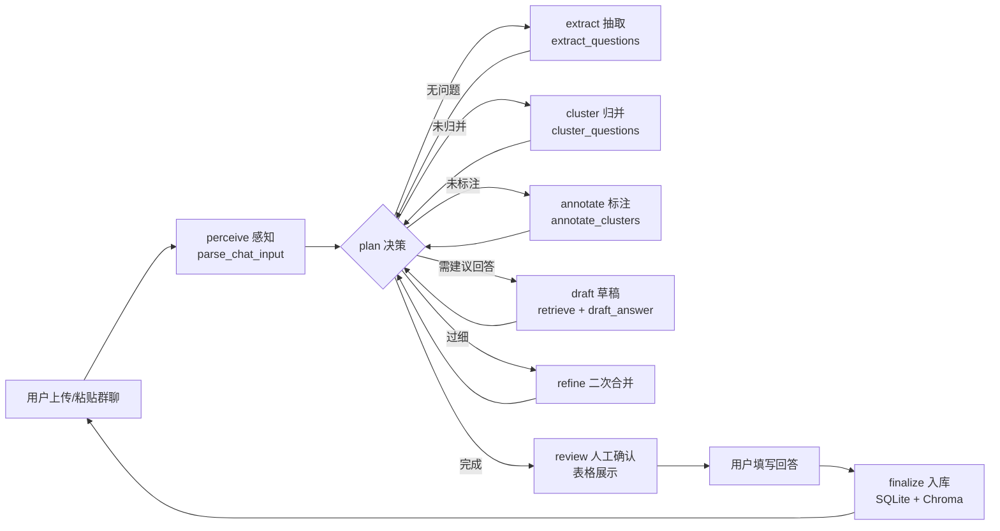

[README.md](https://github.com/user-attachments/files/34901115/README.md)
# 客户问题归并分析 Agent

> 上传群聊记录（Excel / CSV / Word / 纯文本） → Agent 抽取客户诉求 → 合并高频重复问题 → 标注频次与优先级 → 表格化展示 → 人工填写回答 → 沉淀为可复用的长期记忆。

本仓库是《Agent 开发实训单》的完整交付物，技术栈采用**方案一（Python 生态）**：LangGraph + DeepSeek + 自定义 Tool + SQLite/Chroma + Streamlit，并接入 Langfuse Trace（可选）。

---

## 1. 它解决什么问题

客服/售前群里每天有大量重复提问：「退款怎么弄」「退款多久到账」「退款入口在哪」其实是同一个问题。
人工翻聊天记录既慢又容易漏。本 Agent 把非结构化对话变成**可回答的问题清单**：

- 自动识别哪些消息是**客户诉求**（过滤客服回答、寒暄、系统消息）
- 把**同义/同主题**的问题合并成一条规范问法，并给出出现次数、占比、来源
- 按「频次 × 问题类型 × 紧急程度」自动打 **P0 / P1 / P2** 优先级
- 检索历史已答问题，生成**建议回答**草稿
- 表格化呈现，运营同学直接在单元格里改写成最终口径
- 回答提交后写入 SQLite + Chroma，下次遇到同类问题自动复用

## 2. 核心能力

| 能力 | 实现方式 |
| --- | --- |
| 多源输入 | `pandas` 读 Excel/CSV（自动识别内容/发言人/时间列）、`python-docx` 读 Word、正则解析「昵称：内容」与微信「时间 昵称 / 内容」 |
| 问题抽取 | LLM 语义抽取 + 规则兜底（问句线索、故障词、需求词），并识别客服昵称过滤回答 |
| 问题归并 | 三级策略：主题意图（业务域）→ 问题对象（按钮 / 页面 / 商品信息…）→ 字符 n-gram 相似度兜底，LLM 模式下再二次归并 |
| 频次与标注 | 出现次数、占比、问题类型（咨询/需求/故障/投诉）、分类、P0/P1/P2、客户原声 |
| 记忆 | 会话级 checkpoint（LangGraph MemorySaver）+ SQLite 结构化存储 + Chroma 语义检索 |
| 人工确认 | LangGraph `interrupt_before=["finalize"]`，用户填完回答后恢复图执行并入库 |
| 可观测 | 每步 Thought / Action / Observation 展示；Langfuse Trace（配置 key 后自动上报）+ 本地 JSONL |
| 降级 | 无 API Key 时自动进入离线规则模式，全部功能（含演示）可用 |

## 3. 快速开始

```bash
# 1) 安装依赖
python -m pip install -r requirements.txt

# 2) 配置（可选，不配也能跑离线模式）
cp .env.example .env
# 编辑 .env，填入 DEEPSEEK_API_KEY=sk-xxx

# 3) 启动 Web UI
python -m streamlit run app.py
# 打开 http://localhost:8501 → 「载入示例群聊数据」→「开始分析」
```

命令行方式（适合评测与答辩演示）：

```bash
python cli.py --file data/sample_group_chat.csv --answer-demo
python cli.py --file data/sample_group_chat.csv --out data/result.xlsx
python cli.py --text "王女士：退款怎么操作？"
```

Docker：

```bash
docker build -t qa-merge-agent .
docker run -p 8501:8501 --env-file .env qa-merge-agent
```

## 4. 目录结构

```
.
├── app.py                  # Streamlit 单页应用（上传 → 分析 → 表格填写 → 导出）
├── cli.py                  # 命令行入口（评测/演示）
├── src/
│   ├── graph.py            # LangGraph 状态图：感知→决策→工具→人工确认→入库
│   ├── tools.py            # 8 个 Agent 工具 + 工具注册表/调度器
│   ├── llm.py              # DeepSeek/OpenAI 客户端 + JSON 容错 + 离线降级
│   ├── prompts.py          # System Prompt / Few-shot / 输出约束
│   ├── parsers.py          # Excel/CSV/Word/文本解析
│   ├── memory.py           # SQLite 长期记忆 + Chroma 向量库
│   ├── embeddings.py       # 本地确定性 Embedding（哈希 n-gram）
│   ├── observability.py    # Langfuse Trace + 本地 JSONL
│   ├── schemas.py          # Turn / RawQuestion / Cluster 数据结构
│   └── config.py           # 环境变量与全局配置
├── eval/
│   ├── cases.py            # 12 条评测用例
│   └── run_eval.py         # 评测脚本 → docs/eval_results.md
├── data/
│   └── sample_group_chat.csv
├── docs/
│   ├── architecture.md     # 架构设计图与选型对比
│   ├── tool_spec.md        # 工具接口说明（JSON Schema + 示例）
│   ├── prompt_design.md    # Prompt 设计与迭代记录
│   ├── evaluation.md       # 评测记录与失败复盘
│   ├── deployment.md       # 本地/容器/云端部署
│   ├── report.md           # 实训报告（8 节模板）
│   └── eval_results.md     # 评测脚本自动生成
├── requirements.txt
├── Dockerfile
├── .env.example
└── README.md
```

## 5. Agent 工作流



决策逻辑（`src/graph.py: decide_next`）：每个节点执行完都回到 `plan`，由 `plan` 根据 State 判断下一步 Action，而不是固定顺序执行——这正是「Agent 自主决策」与「流水线脚本」的区别。

## 6. 评测

```bash
python eval/run_eval.py
```

当前结果：**12 / 12 通过**，覆盖同义归并、故障描述识别、客服回答过滤、噪声过滤、空输入、上下文继承、微信格式解析、长对话压力。详见 [docs/evaluation.md](docs/evaluation.md) 与自动生成的 [docs/eval_results.md](docs/eval_results.md)。

## 7. 实训单交付物对照

| 实训单要求 | 本仓库位置 |
| --- | --- |
| ① Agent 架构设计图 | [docs/architecture.md](docs/architecture.md) |
| ② 工具接口说明（输入/输出/JSON Schema/示例） | [docs/tool_spec.md](docs/tool_spec.md) |
| ③ 核心源码 + requirements.txt / Dockerfile / .env.example | `src/`、`requirements.txt`、`Dockerfile`、`.env.example` |
| ④ Prompt 设计文档（System / Few-shot / ReAct / 迭代） | [docs/prompt_design.md](docs/prompt_design.md) |
| ⑤ 评测记录（12 条用例 + 失败分析） | [docs/evaluation.md](docs/evaluation.md) |
| ⑥ 部署说明（本地 + 容器） | [docs/deployment.md](docs/deployment.md) |
| ⑦ 实训报告（8 节模板） | [docs/report.md](docs/report.md) |
