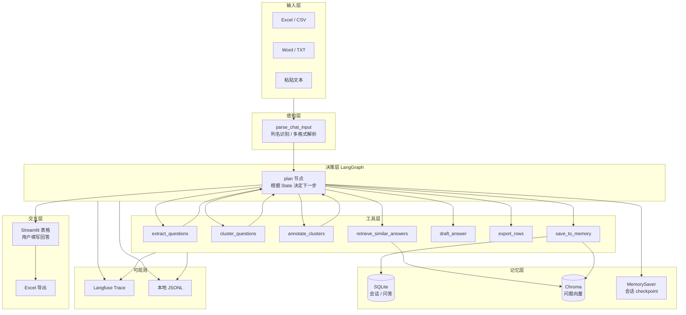
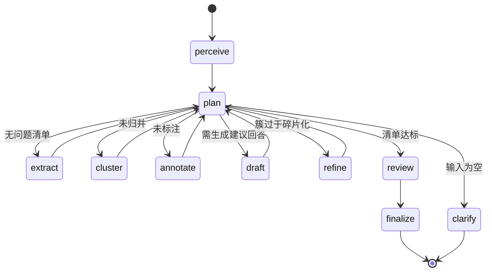

# Agent 架构设计

## 1. 设计目标与约束

| 目标 | 约束 / 决策 |
| --- | --- |
| 从非结构化群聊中得到可回答的问题清单 | 输入格式不可控 → 感知层统一成 `Turn`，下游只处理一种结构 |
| 必须体现「自主决策 + 工具调用」 | 不用固定流水线，改为 LangGraph 条件路由 + `plan` 节点决策 |
| 人工必须能修改回答，不能全自动对外发送 | `interrupt_before=["finalize"]` 人工确认节点，回答由人填写 |
| 课程环境可能没有 API Key / 外网 | LLM 层可降级为规则实现；Embedding 用本地哈希向量 |
| 结果要可解释、可复盘 | 每步记录 Thought / Action / Observation，支持 Langfuse Trace |

## 2. 总体架构

## 3. LangGraph 状态机

`review` 与 `finalize` 之间设置了 `interrupt_before`，图会在此暂停，把控制权交给用户；
用户填完回答后调用 `submit_answers()` → `graph.update_state()` + `graph.invoke(None, config)` 从断点继续，
执行 `finalize` 完成入库。这就是实训单要求的「Human-in-the-loop」。

## 4. State 字段

| 字段 | 类型 | 说明 |
| --- | --- | --- |
| `session_id` | str | 会话 ID，同时作为 LangGraph `thread_id` |
| `file_name` / `file_bytes` / `pasted_text` | str / bytes / str | 原始输入 |
| `business_context` | str | 业务背景，注入 Prompt |
| `turns` | List[Turn] | 感知层输出 |
| `questions` | List[RawQuestion] | 抽取结果 |
| `clusters` | List[Cluster] | 归并 + 标注结果（含建议回答） |
| `annotated` / `drafted` / `refined` | bool | 决策用的进度标记 |
| `settings` | dict | 阈值、是否生成建议回答、是否用记忆 |
| `answer_map` | Dict[cluster_id, answer] | 人工填写的回答 |
| `trace` | List[dict] | Thought / Action / Observation |
| `status` | str | perceived / clustered / awaiting_human / done / empty_input |

## 5. 决策规则（plan）

| 条件 | 下一步 | 理由 |
| --- | --- | --- |
| 没有 turns | `clarify` | 输入不可用，终止并提示 |
| 没有 questions | `extract` | 先有诉求才谈归并 |
| 没有 clusters | `cluster` | 抽取后必须归并 |
| 未标注 | `annotate` | 频次 / 优先级是用户决策依据 |
| 需要建议回答且未生成 | `draft` | 先检索记忆再生成草稿 |
| 单条簇占比 > 70% 且问题数 ≥ 8 | `refine` | 自检发现归并过细，主动放宽阈值再合并一轮（最多 1 次） |
| 其余 | `review` | 交给人工确认 |

## 6. 记忆分层

| 层级 | 存储 | 内容 | 生命周期 |
| --- | --- | --- | --- |
| 工作记忆 | LangGraph `MemorySaver` | 当前图的完整 State | 进程内，按 `thread_id` 隔离 |
| 短期记忆 | SQLite `sessions` | 会话元信息、状态 | 持久化，可列举历史会话 |
| 长期记忆 | SQLite `clusters` | 问题、频次、优先级、人工回答 | 持久化，支持按会话查询 |
| 语义记忆 | Chroma `qa_memory` | 已有人工回答的问题向量 | 持久化，top-k 检索复用口径 |

短期 / 长期没有用 Redis，原因见下表：单机 Streamlit 部署下 SQLite 已足够，
引入 Redis 只增加部署成本；接口层已按「键值 + 结构化查询」封装，替换成本低。

## 7. 方案一各模块的区别与选型

### 7.1 Agent 框架

| 框架 | 抽象方式 | 流程控制 | 循环 / 分支 | 人工介入 | 适用场景 |
| --- | --- | --- | --- | --- | --- |
| **LangGraph** | 状态图（节点 + 边） | 显式，完全可控 | 原生支持条件边、环、断点 | `interrupt` 原生支持 | 需要可控流程 + 工具循环 + 人工确认 |
| LangChain（AgentExecutor） | Chain / Agent 链式组合 | 隐式，黑盒较多 | 依赖 ReAct 循环，调试困难 | 需自己实现 | 快速搭 Demo、标准 RAG |
| CrewAI | 角色（Role）+ 任务（Task） | 角色协作编排 | 以「协作」为中心，不擅长精细分支 | 弱 | 多角色协作、内容生产 |
| AutoGen | 多 Agent 对话 | 会话驱动 | 依赖对话轮次 | 弱 | 多 Agent 讨论、代码执行 |

**本项目选 LangGraph**：需要「解析→抽取→归并→标注→草稿→人工确认」这种带条件分支和自检回环的流程，
并且必须在 `finalize` 前暂停等人填表。CrewAI / AutoGen 的「角色对话」抽象反而增加不确定性。

### 7.2 LLM 调用

| 方案 | 中文效果 | 成本 | Function Calling | 数据合规 | 备注 |
| --- | --- | --- | --- | --- | --- |
| OpenAI API | 好 | 高（需外币卡） | 完善 | 出境 | 生态最全 |
| 通义千问 | 好 | 中 | 支持 | 国内合规 | 阿里云生态 |
| **DeepSeek** | 好 | 低 | 支持（OpenAI 兼容） | 国内 | `base_url` 一行切换，性价比高 |
| Ollama 本地 | 取决于模型 | 零调用费（要算力） | 部分模型支持 | 完全本地 | 演示友好，质量不稳定 |

**选 DeepSeek**：OpenAI 兼容协议让 `ChatOpenAI` 零改造接入，中文与 JSON 输出稳定，成本低。
代码层用 `config.resolve_llm()` 抽象，切换 OpenAI / 通义 / 本地模型只改环境变量。

### 7.3 工具扩展

| 方式 | 形态 | 优点 | 缺点 |
| --- | --- | --- | --- |
| **自定义 Tool（Python 函数）** | 进程内函数 + JSON Schema 描述 | 简单、低延迟、易调试、易单测 | 只能被本进程使用 |
| MCP Server | 独立进程 / 远程服务，标准协议 | 跨应用复用、可被多个 Agent 共享、权限隔离 | 需要额外进程与部署，调试链路长 |

**本项目用自定义 Tool（8 个）**，并统一通过 `run_tool(name, **kwargs)` 调度：
既保留了「Agent 选择工具」的语义，也方便把任意一个工具替换成 MCP Server（只需改 dispatcher）。
课程要求 MCP 为可选，因此选择实现成本更低、可验证性更强的自定义 Tool。

### 7.4 记忆存储

| 方案 | 定位 | 特点 |
| --- | --- | --- |
| Redis | 短期 / 高并发缓存 | 读写快、TTL 方便，但需额外服务、结构化查询弱 |
| **SQLite** | 中小规模结构化持久化 | 零部署、单文件、支持 SQL，适合单机应用与课程交付 |
| 向量库（Chroma 等） | 语义检索 | 解决「字面不同、语义相同」的历史问答复用 |

组合方式：**SQLite 存事实（谁在什么时候问了什么、答了什么），Chroma 存语义（相似问题检索）**，
LangGraph `MemorySaver` 存当前图状态。Redis 在当前单机场景是过度设计，故未引入。

### 7.5 向量数据库

| 方案 | 部署 | 检索能力 | 适用规模 |
| --- | --- | --- | --- |
| FAISS | 纯本地库文件 | 快，但需自行管理元数据与持久化 | 单机、离线 |
| **Chroma** | 嵌入式（`PersistentClient`）或服务 | 元数据过滤 + 持久化开箱即用 | 万级以内 |
| Milvus | 分布式集群 | 最强，支持亿级 | 企业级、需运维 |

**选 Chroma**：`PersistentClient` 零服务启动，自带元数据与 collection 管理，最适合本项目「问题量不大但有语义检索需求」的场景。
注意：DeepSeek 不提供 embedding 接口，因此 `src/embeddings.py` 实现了本地哈希 n-gram 向量（确定性、无需下载模型），
在线环境可无痛替换为 BGE / text-embedding-3。

### 7.6 可观测性

| 方案 | 形态 | 优点 | 缺点 |
| --- | --- | --- | --- |
| LangSmith | SaaS（可自托管企业版） | 与 LangChain 深度集成、UI 成熟 | 境外服务、免费额度有限 |
| **Langfuse** | 开源，可云可自托管 | 可私有化、成本低、支持 span/generation/评分 | 需要自己部署（云版也简单） |

**选 Langfuse**：`src/observability.py` 用 `observe_node()` 装饰器包裹每个图节点，
配置 key 后自动上报 span；未配置时退化为本地 JSONL Trace（`data/traces/{session}.jsonl`），
保证任何环境都能复盘决策过程。

## 8. 关键取舍

1. **先规则、后模型**：LLM 负责语义抽取与命名，规则负责兜底与校验（如覆盖完整性检查），避免模型抖动导致结果不可用。
2. **主题词典 + 问题对象 + 相似度三级归并**：纯向量相似度在短文本上不稳定（实测同义问法相似度可能接近 0），
   主题意图归并保证召回，相似度聚类兜住长尾。
3. **人工回答优先于模型生成**：模型只产出建议草稿，最终口径由人填写，符合对外沟通的风险要求。
4. **降级不降功能**：离线模式仍能完成全部链路，保证答辩现场无网络也能演示。
