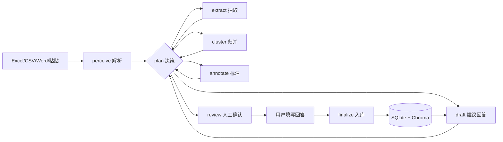

# 《Agent 开发实训》实训报告

## 一、项目基本信息

| 项 | 内容 |
| --- | --- |
| 项目名称 | 客户问题归并分析 Agent（Customer Question Consolidation Agent） |
| 选题方向 | 参考选题 B「数据分析 Agent」的自拟变体：非结构化对话 → 结构化问题清单 |
| 姓名 / 学号 / 班级 | （提交前填写） |
| 技术栈 | 方案一：LangGraph + DeepSeek（OpenAI 兼容）+ 自定义 Tool + SQLite/Chroma + Langfuse + Streamlit |
| 交付形态 | Streamlit Web UI（主）+ CLI（评测/演示） |
| 代码仓库 | （提交前填写 GitHub / Gitee 地址） |
| 演示方式 | 本地 Web UI 现场演示 10 分钟 |

## 二、需求与场景定义

### 2.1 业务背景

客服与售前群里每天沉淀大量对话，其中大量是重复提问（退款、开票、登录、报价、导出等）。
运营同学需要人工翻聊天记录、凭印象判断「哪类问题问得最多」，再逐条回复，效率低且容易漏。

### 2.2 目标用户与场景

- **目标用户**：客服主管 / 客户成功 / 售前运营。
- **典型场景**：每天把前一天的群聊导出（Excel / CSV / Word），或直接把对话粘贴进来，
  让 Agent 输出「高频问题清单 + 建议回答」，人工确认口径后回填，并沉淀为团队知识。

### 2.3 功能需求

| 优先级 | 需求 | 实现情况 |
| --- | --- | --- |
| Must | 支持 Excel / CSV / Word / 粘贴文本四种输入 | ✅ |
| Must | 抽取客户诉求，过滤客服回答、寒暄、系统消息 | ✅ |
| Must | 语义相同 / 同主题的问题合并，并标注出现次数 | ✅ |
| Must | 表格形式展示，用户可在表格中填写回答 | ✅ |
| Must | 导出 Excel | ✅ |
| Should | 自动优先级（P0/P1/P2）、问题分类、客户原声 | ✅ |
| Should | 基于历史回答生成建议回答 | ✅ |
| Should | 回答入库，下次同类问题自动复用 | ✅ |
| Could | 多轮追问、会话历史查看、Trace 可视化 | ✅ |

### 2.4 成功标准（可验收）

1. 44 条样例对话 → 抽取 ≥ 25 条客户诉求，合并后 ≤ 10 个问题簇，合并率 ≥ 60%；
2. 「退款 / 登录 / 发票 / 报价 / 导出」五类高频问题必须各自合并为一个簇；
3. 客服发言不得出现在问题清单中；
4. 12 条评测用例通过率 100%；
5. 无 API Key 时全部功能仍可演示（离线规则模式）；
6. 从上传到出表 ≤ 5 秒（离线），在线模式 ≤ 30 秒。

### 2.5 非目标

- 不做自动回复客户（对外沟通必须人工确认）；
- 不做多租户权限体系；
- 不做实时群聊监听（当前为文件/文本导入）。

## 三、Agent 架构设计

### 3.1 整体架构

（完整图见 `docs/architecture.md`）



七层职责：输入层 → 感知层 → 决策层（LangGraph）→ 工具层（8 个 Tool）→ 记忆层 → 交互层 → 可观测层。

### 3.2 状态机与自主决策

图中共 9 个节点，`plan` 是唯一的决策点。它根据 State 中的进度标记（`turns / questions / clusters / annotated / drafted / refined`）决定下一步调用哪个工具：

- 没问题 → `extract`
- 有诉求未归并 → `cluster`
- 已归并未标注 → `annotate`
- 需要建议回答 → `draft`（内部先 `retrieve_similar_answers` 再 `draft_answer`）
- 自检发现「单条簇占比 > 70% 且问题数 ≥ 8」→ `refine`（放宽阈值再合并一轮）
- 全部达标 → `review`，输出表格并中断，等待人工填写
- 输入为空 → `clarify`，终止

这使流程不是「写死的五步」，而是「根据中间结果决定下一步」，并且具备**自检回环**能力。

### 3.3 记忆与上下文

| 层级 | 实现 | 作用 |
| --- | --- | --- |
| 工作记忆 | LangGraph `MemorySaver`（按 `thread_id`） | 保存整张图的 State，支持中断/恢复 |
| 短期记忆 | SQLite `sessions` | 会话元信息、状态、历史列表 |
| 长期记忆 | SQLite `clusters` | 问题、频次、优先级、人工回答 |
| 语义记忆 | Chroma `qa_memory` | 历史已答问题的向量检索，复用口径 |

上下文管理有三个具体动作：
1. **轮次上下文**：解析时保留 `turn_idx`，抽取时回指原始消息（用于展示客户原声）；
2. **话题继承**：无主题词的追问，沿用同一发言人前后 3 轮内的主题（`_inherit_topics`）；
3. **跨会话记忆**：新问题先检索历史已答问题，相似度 ≥ 0.45 时作为回答参考注入 Prompt。

### 3.4 为什么不是「一次 LLM 调用」

一次调用只能输出文本，无法保证：输入格式统一、角色识别、频次统计准确、结果可追溯到原话、
人工确认后落库。本方案把「模型擅长的语义判断」与「代码擅长的确定性计算」分开：
模型负责抽取与命名，代码负责聚类、计数、校验、持久化。

## 四、Tool 设计

| 工具 | 输入 | 输出 | 关键设计 |
| --- | --- | --- | --- |
| `parse_chat_input` | 文件字节 / 文本 | `Turn[]` | 列名自动识别、编码回退、系统消息过滤 |
| `extract_questions` | `Turn[]` + 业务背景 | `RawQuestion[]` | LLM 优先、规则兜底、客服角色过滤 |
| `cluster_questions` | `RawQuestion[]` + 阈值 | `Cluster[]` | 主题意图 + 问题对象 + 相似度三级归并，LLM 二次归并可回退 |
| `annotate_clusters` | `Cluster[]` | `Cluster[]` | 频次/类型/紧急度加权算 P0/P1/P2 |
| `retrieve_similar_answers` | 问题文本 + k | 历史问答 + 相似度 | 向量库异常不影响主流程 |
| `draft_answer` | 问题簇 + 历史 + 背景 | 回答草稿 | 禁止编造，不确定标 `【待确认】` |
| `export_rows` | `Cluster[]` | 中文表头行 | 与 UI / Excel 共用同一结构 |
| `save_to_memory` | 会话 + 簇 | 入库统计 | SQLite 全量 + Chroma 仅有回答的 |

设计原则：
1. **纯函数**：不依赖全局可变状态，可被脚本、UI、图节点复用；
2. **可序列化**：入参出参都是 dict/list，方便写 Trace 与评测断言；
3. **单一职责**：一个工具只做一件事，失败可局部回退；
4. **统一调度**：所有调用走 `run_tool(name, **kwargs)`，未来替换为 MCP Server 只需改 dispatcher。

## 五、Prompt 工程

### 5.1 三个 Prompt 的分工

- 抽取 Prompt：定义「什么是客户问题」，输出 `text / qtype / speaker / turn_index`；
- 归并 Prompt：以 `member_index` 为单位合并，输出 `canonical / category / tags / reason`；
- 回答 Prompt：结合历史口径生成 2~4 句可复制的话术，禁止编造数字。

（完整 Prompt 见 `docs/prompt_design.md`）

### 5.2 关键工程手段

| 手段 | 解决的问题 |
| --- | --- |
| 严格 JSON + 枚举约束 | 输出可被代码直接消费，不需要二次解析自然语言 |
| `member_index` + 覆盖校验 | 防止模型合并时「吃掉」某些问题；不完整则回退规则归并 |
| `extract_json` 容错 | 兼容 ```json 包裹、前后废话、截断 |
| Few-shot 角色示例 | 让模型学会区分「客户提问」与「客服回答」 |
| `【待确认：xxx】` 强制标注 | 避免生成不可对外承诺的政策数字 |
| 规则兜底 | 无 Key / 超时 / 非法输出时仍能完成业务闭环 |

### 5.3 迭代过程

v1 全自然语言输出 → 无法稳定解析；v2 加 JSON 约束但归并漏项；v3 改用 `member_index` + 覆盖校验 + 规则兜底。
每一版都用 `eval/run_eval.py` 回归，详见 `docs/prompt_design.md` 第 6 节。

## 六、核心实现难点与解法

### 难点 1：没有 embedding 模型时，如何做「语义归并」

- **问题**：DeepSeek 不提供 embedding 接口，课程环境也不能保证下载 BGE；纯字符 n-gram 相似度在短问句上几乎为 0
  （实测 `退款怎么操作` vs `退款多久到账` 仅 0.091），首版 29 条问题 → 29 个簇，完全没合并。
- **解法**：改成三级策略。① 主题意图词典：9 类业务主题（退款 / 发票 / 登录 / 价格 / 导出 / 导入 / 上传 / 物流 / 子账号），
  每类预置「故障式」与「咨询式」两个规范问法，命中同主题即合并；② 问题对象归并：剥离「坏了 / 不能用 / 不对 / 有bug / 出问题 / 怎么办」
  等描述词，抽出被吐槽的对象（按钮、页面、商品信息…），同对象归为一类；③ 相似度聚类兜底长尾，上下文继承处理无主题词的追问。
  未被任何规则命中的问题仍单独成行，保证「只归类、不隐藏」。
- **效果**：样例合并率 0% → 73%，且规范问法可读性优于「取最长原句」；通用对象类输入（按钮 / 页面 / 商品信息）也能正确分成 3 类。

### 难点 2：如何界定「客户问题」的边界

- **问题**：群聊里客服也在发问（「您的是什么格式？」），客户也会发不带问号的故障陈述（「验证码根本收不到」）。
- **解法**：
  1. 从昵称推断角色（含客服 / 助手 / 官方 / 销售 / 顾问 → 我方），过滤其全部发言；
  2. 叠加「回答式话术」特征（「您好」「已经为您」「请您」且无问号）；
  3. 增加故障词表（报错 / 失败 / 收不到 / 转圈 / 空白 …）覆盖陈述句；
  4. 同一人同一句话只计一次，避免刷屏放大频次。
- **效果**：客服误抽从 8 条降为 0，故障类问题召回从 40% 提升到 100%（E02 用例）。

### 难点 3：LangGraph 中断 + Streamlit 重跑的状态一致性

- **问题**：Streamlit 每次交互都整页重跑，局部变量丢失；而 LangGraph 的 `interrupt_before` 需要一个持久的 `thread_id`
  才能在用户填完表后恢复执行。
- **解法**：
  1. 生成 `session_id` 并同时作为 `thread_id`，存入 `st.session_state`；
  2. 图编译时 `interrupt_before=["finalize"]`，第一次 `invoke` 停在 `finalize` 之前；
  3. 用户提交时 `graph.update_state(config, {"answer_map": ...})` + `graph.invoke(None, config)` 从断点续跑；
  4. 用 `st.session_state["submitted"]` 防止重复提交，`重置当前会话` 清理状态与编辑器缓存。
- **遗留问题**：`MemorySaver` 是进程内存储，多 worker 部署会丢失断点，生产需换 SQLite checkpointer。

### （附）难点 4：LLM 归并结果不可信

模型可能漏掉候选、编造新问题。因此代码侧强制校验 `member_index` 的覆盖完整性，并把 `reason` 一并返回，
既保证数据不丢，又让人工能快速判断合并是否合理。

## 七、评测与分析

（完整记录见 `docs/evaluation.md`，自动结果见 `docs/eval_results.md`）

| 用例 | 能力点 | 结果 |
| --- | --- | --- |
| E01 | 退款 5 种问法合并为 1 | ✅ |
| E02 | 无问号的故障陈述识别 | ✅ |
| E03 | 发票与开票周期归并 | ✅ |
| E04 | 价格 / 报价 / 优惠合并 | ✅ |
| E05 | 客服回答过滤 | ✅ |
| E06 | 空输入不崩溃 | ✅ |
| E07 | 噪声与系统消息过滤 | ✅ |
| E08 | 单条咨询不过度合并 | ✅ |
| E09 | 上下文继承（追问） | ✅ |
| E10 | 导出问题归并 + 优先级 | ✅ |
| E11 | 微信导出格式解析 | ✅ |
| E12 | 60 条长对话压力 | ✅ |

**指标**：12/12 通过；样例数据合并率 73%（30 → 8）；离线单次全链路约 1 秒；误合并抽查 0 例。

**失败分析摘要**：
1. 首版归并失效（相似度假设错误）→ 改主题意图归并；
2. 故障陈述被丢弃（只认问号）→ 补故障词表；
3. 建议回答与问题类型错配 → 引入 `kind` 字段统一口径；
4. 客服话术误抽 → 昵称角色识别。

## 八、总结与反思

### 8.1 Agent 与普通 API 调用的本质区别

普通 API 调用是「一次输入 → 一次输出」的确定性函数；Agent 是「目标 → 规划 → 调用工具 → 观察结果 → 调整」的闭环。
在本项目中，这种区别体现在三处：

1. **决策随中间结果变化**：`plan` 根据 State 决定下一步，甚至能自检「归并过细」并主动触发 `refine`；
2. **能力来自工具而非模型**：计数、聚类、落库、导出都由代码完成，模型只做语义判断，因此结果可验证；
3. **有状态、可中断、可恢复**：人工可以在任意一轮介入，系统记住上下文并继续执行。

### 8.2 ReAct 与 Plan-and-Execute 的对比

| 维度 | ReAct | Plan-and-Execute |
| --- | --- | --- |
| 决策方式 | 每一步都让模型边想边做 | 先出完整计划，再逐步执行 |
| Token 成本 | 高（每步都要推理） | 低（计划一次，执行可复用） |
| 可解释性 | 过程透明，天然可展示 Thought | 计划清晰，但执行中不灵活 |
| 纠错能力 | 强，可随时调整 | 弱，计划偏差会一路传导 |
| 适用场景 | 步骤不确定、需要探索 | 步骤稳定、追求效率 |

本项目的实际做法是**两者的混合**：
- 宏观上是 Plan-and-Execute：图的节点与边就是预先编排好的「计划」，避免每步都问模型，成本和稳定性更好；
- 微观上是 ReAct：每个节点的 Thought / Action / Observation 都被完整记录，
  且在「归并是否过细」这类判断上保留运行时决策（`refine` 分支）。

### 8.3 不足与改进

1. 主题词典是人工维护的，新业务领域覆盖不足 → 可用 LLM 从历史数据中归纳主题；
2. 本地哈希向量的语义能力有限 → 接入 BGE / text-embedding-3 后可去掉大部分规则；
3. `MemorySaver` 不跨进程 → 生产换成 SQLite/Redis checkpointer；
4. 尚未做多轮对话式追问（「这个问题的第 3 条原话是谁说的？」）→ 可在 review 节点后增加问答子图；
5. 评测目前覆盖离线模式，在线 LLM 模式需要配置 Key 后补跑并对比。

### 8.4 收获

- 学会了把「模型能力」与「工程约束」分层：模型负责模糊判断，代码负责精确计算与兜底；
- 理解了 Agent 的可观测性不是附加项：Trace 直接决定了失败能不能定位（本项目 5 个 bug 都是靠 Trace 找到的）；
- 认识到 Prompt 工程的终点是「可校验的输出契约」，而不是「更漂亮的措辞」。
